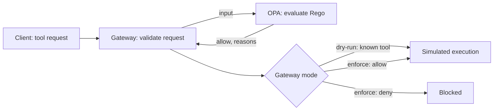

# Tool Risk Gateway: OPA policy demo

A small, runnable policy enforcement point for tool calls. Compare **dry-run** and **enforce** using the same Open Policy Agent (OPA) rules. All tool execution is simulated: the gateway never deletes, exports, sends, or searches real data.



## Quick start

Requires Docker with Compose. From this directory:

```bash
docker compose up --build -d
./examples/compare.sh
```

The script submits an identical restricted export request to both gateways. You should see:

| Mode | OPA decision | Simulated execution | HTTP |
| --- | --- | --- | --- |
| Dry-run (`localhost:8081`) | deny | yes | 200 |
| Enforce (`localhost:8082`) | deny | no | 403 |

Both report `restricted data cannot be exported`. In dry-run, known tools with valid classifications proceed to the **simulated** executor even when policy denies. Unknown tools and classifications are never dispatched, including in dry-run. An OPA failure blocks requests in both modes with HTTP 503. There is no real side effect in either mode.

Try an allowed search:

```bash
curl -sS http://localhost:8082/v1/tools/invoke \
  -H 'Content-Type: application/json' \
  -d '{"tool":"search_documents","classification":"internal","destination":"","roles":[]}'
```

Stop the stack with `docker compose down`. The gateways listen on localhost; OPA is only accessible on the Compose network. `/health` reports that the gateway process is running, not that OPA is ready. Compose starts containers in order but does not wait for OPA readiness; retry a 503 during startup.

## Policy rules

| Rule | Decision |
| --- | --- |
| Unknown tool or classification | Deny |
| Delete documents | Deny |
| Export restricted documents | Deny, including for reviewers |
| Export other documents | Allow only with `reviewer` role |
| Send externally | Allow only to exactly `partner.example.com` and only non-restricted data |
| Search documents | Allow for known classifications |

Multiple violations produce multiple sorted reasons. The destination is a literal hostname label in this demo, not a URL or a network destination verification mechanism.

The API accepts exactly four JSON fields: `tool` (string), `classification` (`public`, `internal`, or `restricted`), `destination` (string; empty when unused), and `roles` (array of strings). Invalid JSON or field shapes return 400. A policy denial in enforce mode returns 403; a missing, malformed, or unavailable OPA decision returns 503. The mode is configured on the server, not selected in the request.

## Tests

```bash
# Python standard library; no external packages
python3 -m unittest discover -s tests -v
# Rego tests using the same pinned OPA image as Compose
docker run --rm -v "$PWD/policy:/policy:ro" openpolicyagent/opa:1.22.3 test /policy -v
# End-to-end tests against the running Compose stack
python3 tests/integration.py
```

GitHub Actions runs the Python, Rego, and Compose integration tests. For inspection, `docker compose logs -f` shows tool name, decision, and outcome; it intentionally avoids logging the full input.

## Security boundary and production work

In a real deployment derive identity and permissions from trusted services, resolve classification from an authoritative document store, protect and authenticate OPA traffic, enforce at every real tool invocation, and fail closed. Dry-run would allow denied actions if connected to a real executor, so do not use it as a security control. Review policy deployment, observability, data handling, and threat models before production use.

OPA evaluates the policy through its [Data API](https://www.openpolicyagent.org/docs/rest-api). Rego policy tests are documented in [OPA policy testing](https://www.openpolicyagent.org/docs/policy-testing).
